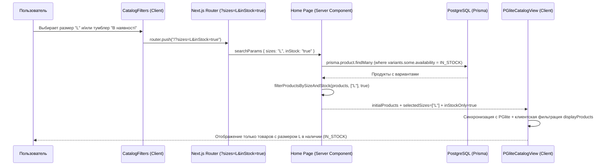

# Задача №3: Фильтрация по размеру (`Size`) и наличию (`In Stock Only` / «Скрыть Sold Out»)

## 1. Контекст и бизнес-проблема (ПОЧЕМУ)

### Продуктовая проблема
В агрегаторе стритвир-дропов и локальных брендов (`DropAgg`) сценарий покупки одежды всегда начинается с двух базовых вопросов пользователя:
1. **«Есть ли этот айтем в наличии прямо сейчас?»**
2. **«Доступен ли мой размер (`S`, `M`, `L`, `XL` и т.д.) для покупки?»**

В текущей реализации:
- В БД (`ProductVariant`) уже хранятся поля `size` (`S`, `M`, `L`, `XL`, `OS` и др.) и `availability` (`IN_STOCK` | `OUT_OF_STOCK`).
- На карточке товара при наведении (hover) уже отображается сетка размеров с перечеркнутыми `OUT_OF_STOCK` вариантами и бейджем `ПРОДАНО` (`SOLD OUT`), если все варианты раскуплены.
- Однако в боковой панели фильтров (`CatalogFilters`), серверной выборке (`src/app/page.tsx`) и клиентском PGlite-движке (`src/components/catalog/pglite-catalog-view.tsx`) **полностью отсутствует фильтрация по размерам и статусу наличия**.

### Почему это критично для конверсии и удержания (Retention)
1. **Защита от фрустрации (False Positive Stock)**: Если пользователь носит размер `L`, ему бесполезно видеть худи, у которого в наличии остался только `XS`, а `L` давно `OUT_OF_STOCK`. Обычный текстовый фильтр по полю `size` без проверки `availability === "IN_STOCK"` покажет пользователю проданный размер, что приведет к пустому переходу во внешний магазин и потере доверия к агрегатору.
2. **Чистота ленты дропов («Скрыть Sold Out»)**: У многих локальных и стритвир-брендов в каталоге остаются архивные дропы со статусом `OUT_OF_STOCK`. Для режима «хочу купить сейчас» пользователю нужен быстрый тумблер **«Тільки в наявності / Приховати Sold Out»** (`inStock=true`), при этом по умолчанию архивные вещи могут оставаться доступными для добавления в `Favorites` и отслеживания рестоков.
3. **Разнородность размерных сеток в Shopify / Tilda / Custom магазинах**: Разные магазины отдают размеры в разных форматах (`"S"`, `"Small"`, `"M"`, `"Medium"`, `"2XL"`, `"XXL"`, `"One Size"`, `"Default Title"`, `"S/M"`). Без нормализации размеров фильтр в агрегаторе распадется на десятки дублирующихся кнопок.

---

## 2. Что именно нужно реализовать (ЧТО)

1. **Нормализация и матчинг размеров (`Size Normalizer & Matcher`)**:
   - Приведение сырых названий размеров из магазинов к каноническим значениям: `XS`, `S`, `M`, `L`, `XL`, `XXL`, `OS` (One Size), с сохранением поддержки числовых и нестандартных размеров.
   - Корректная обработка сдвоенных размеров (например, вариант `"S/M"` или `"S-M"` должен матчиться при выборе пользователем как `S`, так и `M`).
   - Преобразование технических заглушек Shopify (`"Default Title"`, `"One Size"`, `"Єдиний розмір"`, `"Універсальний"`) в канонический размер `OS`.

2. **Тумблер наличия (`In Stock Only` / «Скрыть Sold Out») в `CatalogFilters`**:
   - Быстрый переключатель в сайдбаре и мобильном меню фильтров, синхронизированный с URL-параметром `?inStock=true`.
   - При включении скрывает все товары, у которых нет ни одного варианта со статусом `availability === "IN_STOCK"`.

3. **Мультиселект-фильтр размеров (`Size` Pills Grid) в `CatalogFilters`**:
   - Компактная сетка кнопок-пиллов (`XS`, `S`, `M`, `L`, `XL`, `XXL`, `OS` + динамически обнаруженные популярные размеры в каталоге), синхронизированная с URL-параметром `?sizes=M,L`.
   - Поддержка одновременного выбора нескольких размеров (логическое `OR` между выбранными размерами).
   - **Строгое правило проверки наличия**: товар проходит фильтр по размеру `X` **только тогда**, когда у него есть вариант, соответствующий размеру `X`, И у этого же варианта `availability === "IN_STOCK"`.

4. **Сквозная фильтрация на всех уровнях (SSR + PGlite WASM + JS Client Fallback)**:
   - Серверный рендеринг в `src/app/page.tsx` (Prisma + пост-фильтрация нормализованных размеров).
   - Клиентский слой в `src/components/catalog/pglite-catalog-view.tsx` (PGlite SQL + JS-фильтрация и сброс пагинации Infinite Scroll при изменении `sizes` или `inStock`).

---

## 3. Архитектура и затронутые файлы (ГДЕ)

| Файл | Роль в архитектуре | Что изменяется / добавляется |
| :--- | :--- | :--- |
| `src/lib/size-filter.ts` *(новый)* | Доменная логика нормализации и фильтрации размеров/наличия | Каноническая нормализация размеров (`normalizeSize`), извлечение списка доступных размеров каталога (`extractAvailableSizes`), проверка товара по размеру и наличию (`filterProductsBySizeAndStock`). |
| `src/lib/i18n.ts` | Локализация (`uk` / `en`) | Ключи перевода для секции `sizes`, тумблера `inStockOnly` / `hideSoldOut`, подсказок и пустых состояний. |
| `src/components/catalog/catalog-filters.tsx` | UI-компонент фильтров (Desktop Sidebar + Mobile Drawer) | Чтение/запись query-параметров `sizes` и `inStock`, счетчик активных фильтров (`activeCount`), UI-тумблер «В наявності (Приховати Sold Out)» и сетка кнопок выбора размеров (`Size`). |
| `src/app/page.tsx` | Server Component главной страницы каталога | Чтение `sizes` и `inStock` из `searchParams`, композиция условий фильтрации вариантов (без перезаписи `where.variants` при одновременном `maxPrice`), вычисление `availableSizes` и передача пропсов в `CatalogFilters` и `PGliteCatalogView`. |
| `src/components/catalog/pglite-catalog-view.tsx` | Client Component сетки каталога + PGlite WASM | Поддержка `selectedSizes` и `inStockOnly` (из пропсов и `useSearchParams`), фильтрация в PGlite и `displayProducts`, сброс `visibleCount` при смене фильтров, визуальная подсветка выбранного размера на оверлее карточки. |

---

## 4. Детальное техническое описание реализации (КАК)

### 4.1. Модуль нормализации и фильтрации размеров (`src/lib/size-filter.ts`)

В реальных фидах Shopify (`sp.variants`) и Tilda размеры приходят в неструктурированном виде. Модуль `src/lib/size-filter.ts` вводит:

1. **Канонический порядок стандартных размеров**:
   ```ts
   export const STANDARD_SIZES = ["XS", "S", "M", "L", "XL", "XXL", "OS"] as const;
   ```
2. **Функция `normalizeSize(rawSize?: string | null): string[]`**:
   - Принимает сырую строку размера варианта и возвращает массив канонических токенов (например, `"S/M"` -> `["S", "M"]`, `"Extra Large"` -> `["XL"]`, `"2XL"` / `"XX-Large"` -> `["XXL"]`, `"Default Title"` / `"One Size"` / `"One size"` / `"Універсальний"` -> `["OS"]`).
   - Это позволяет варианту с маркировкой `"S/M"` корректно находиться и при фильтре `S`, и при фильтре `M`.
3. **Функция `filterProductsBySizeAndStock(products, selectedSizes, inStockOnly)`**:
   - Если `selectedSizes.length === 0` и `!inStockOnly` — возвращает исходный список `products`.
   - Если `inStockOnly === true` и `selectedSizes.length === 0`:
     - Оставляет только те товары, у которых `variants.some(v => v.availability === "IN_STOCK")`.
   - Если `selectedSizes.length > 0` (независимо от флага `inStockOnly`, так как выбор размера всегда подразумевает наличие этого размера):
     - Оставляет только те товары, у которых существует хотя бы один вариант `v`, где:
       - `v.availability === "IN_STOCK"`
       - И пересечение `normalizeSize(v.size)` с `selectedSizes` не пусто.
4. **Функция `extractAvailableSizes(products)`**:
   - Сканирует все варианты товаров в каталоге, нормализует их размеры и возвращает отсортированный список доступных размеров (сначала стандартные `XS, S, M, L, XL, XXL, OS`, затем числовые/дополнительные в порядке возрастания). Если база пуста или содержит только часть стандартных размеров, гарантирует наличие базовой линейки `["XS", "S", "M", "L", "XL", "XXL", "OS"]`.

### 4.2. Исправление композиции `where.variants` в `src/app/page.tsx`

В текущем коде `src/app/page.tsx` фильтр по цене записан так:
```ts
if (maxPriceFilter !== undefined) {
  where.variants = {
    some: {
      OR: [
        { normalizedPrice: { lte: maxPriceFilter } },
        { rawPrice: { lte: maxPriceFilter } },
      ],
    },
  };
}
```
Если просто добавить поверх этого `where.variants = { some: { availability: "IN_STOCK" } }`, то условие `maxPriceFilter` будет перезаписано!
Более того, в Prisma условие `variants: { some: { ... } }` должно проверять, что **один и тот же вариант** удовлетворяет и цене, и наличию (`availability: "IN_STOCK"`):
```ts
const variantConditions: any[] = [];

if (maxPriceFilter !== undefined) {
  variantConditions.push({
    OR: [
      { normalizedPrice: { lte: maxPriceFilter } },
      { rawPrice: { lte: maxPriceFilter } },
    ],
  });
}

if (inStockOnly || sizeFilters.length > 0) {
  variantConditions.push({
    availability: "IN_STOCK",
  });
}

if (variantConditions.length > 0) {
  where.variants = {
    some: variantConditions.length === 1 ? variantConditions[0] : { AND: variantConditions },
  };
}
```
А после загрузки из Prisma применяется `filterProductsBySizeAndStock(products, sizeFilters, inStockOnly, maxPriceFilter)`, который выполняет точную фильтрацию по нормализованным размерам (`normalizeSize`) и проверяет, что именно **доступный (`IN_STOCK`) вариант нужного размера** также укладывается в `maxPriceFilter` (если задан `maxPrice`).

### 4.3. Обновление UI в `src/components/catalog/catalog-filters.tsx`

1. **Новые параметры URL**:
   - `inStock`: `"true"` | `null` (управляется тумблером «В наявності / Приховати Sold Out»).
   - `sizes`: список размеров через запятую, например `"M,L"` (управляется кликами по кнопкам размеров).
2. **Счетчик активных фильтров (`activeCount`)**:
   - Учитывает `(isInStockOnly ? 1 : 0) + selectedSizes.length`.
3. **UI-компоненты**:
   - **In Stock Toggle**: Кнопка-переключатель рядом с `Favorites Only` с иконкой `PackageCheck` / индикатором наличия и зеленым акцентом (`emerald-500`) в активном состоянии.
   - **Size Filter Grid**: Секция «Розмір / Size» с кнопками размеров (`grid-cols-4 gap-1.5`), поддерживающая мультивыбор и быстрый сброс.

### 4.4. Обновление `src/components/catalog/pglite-catalog-view.tsx`

1. Чтение `sizes` и `inStock` с приоритетом живого клиентского URL (`useSearchParams()`) и fallback на серверные пропсы (`selectedSizes`, `inStockOnly`), чтобы снятие/переключение фильтра в URL мгновенно отражалось на клиенте.
2. В PGlite WASM SQL-запросе:
   - Использование подзапросов `EXISTS (SELECT 1 FROM product_variants ...)` для фильтрации по `maxPriceFilter` и `availability = 'IN_STOCK'`, чтобы `json_agg` возвращал полный список вариантов товара для hover-оверлея карточки (не обрезая более дорогие или проданные размеры).
   - Использование `COALESCE(json_agg(...) FILTER (WHERE pv.id IS NOT NULL), '[]'::json)` для безопасной агрегации `LEFT JOIN` без `null`-объектов.
   - Использование агрегатных выражений `MIN(pv.normalized_price) ASC NULLS LAST` и `MAX(pv.normalized_price) DESC NULLS LAST` в `ORDER BY` при `GROUP BY p.id`.
3. Добавление `JSON.stringify(activeSizes)` и `activeInStockOnly` в массив зависимостей `useEffect`, сбрасывающего `visibleCount` (`ITEMS_PER_CHUNK`) и обновляющего выборку PGlite.
4. Применение `filterProductsBySizeAndStock` к `displayProducts` (работает идентично как поверх данных PGlite WASM, так и поверх серверных `initialProducts`).
5. На карточке товара при наведении (hover-оверлей с размерами) размеры, совпавшие с выбранным фильтром `activeSizes` и находящиеся в наличии, получают акцентное выделение (`bg-emerald-400 text-black ring-2 ring-white`), чтобы пользователь сразу видел совпадение.

---

## 5. Поток данных (Data Flow)



---

## 6. Граничные случаи (Edge Cases) и их обработка

1. **Товар имеет выбранный размер `L`, но его статус `OUT_OF_STOCK`, а размер `S` — `IN_STOCK`**:
   - Проверка `availability === "IN_STOCK"` и проверка `size === "L"` выполняются **на одном и том же объекте `ProductVariant`**, а не раздельно по товару. Такой товар **не попадет** в выдачу по размеру `L`.
2. **Товар имеет вариант `L` (`IN_STOCK`) за $600 и вариант `S` (`IN_STOCK`) за $80, а фильтр: `sizes=L` + `maxPrice=100`**:
   - Проверка `maxPrice`, `size` и `availability === "IN_STOCK"` проверяется атомарно на уровне варианта, чтобы товар за $600 в размере `L` не проходил из-за дешевого размера `S`.
3. **Нестандартные названия размеров из Shopify/Tilda (`"Default Title"`, `"One Size (Universal)"`, `"Size: Large"`, `"Розмір: M"`, `"48-50 (M)"`, `"2XL"`, `"S/M"`)**:
   - Нормализатор `normalizeSize` очищает префиксы (`Size:`, `Розмір -`) и скобочные пояснения, приводит `"Default Title"` и `"One Size (Universal)"` к `"OS"`, `"48-50 (M)"` к `"M"`, `"2XL"` к `"XXL"`, а `"S/M"` сопоставляет и с `"S"`, и с `"M"`.
4. **Защита сетки размеров от мусорных значений (`isValidSizeToken`)**:
   - Если в сырых данных магазина в поле `size` попало название цвета (`"Black"`, `"Olive"`, `"White"`), `isValidSizeToken` отфильтровывает такие строки из `extractAvailableSizes`, допуская в UI только валидные буквенные (`XXS`–`4XL`, `OS`) и числовые/обувные размеры.
5. **Товар вообще без вариантов (`variants: []`)**:
   - Безопасно отфильтровывается при включенном `inStockOnly` или выбранных `sizes`, не вызывая ошибок чтения `undefined`.

