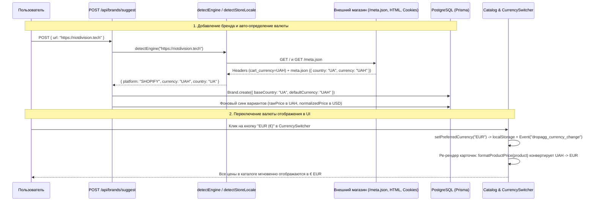

# Задача №4: Авто-определение валюты и страны магазина при добавлении бренда и переключатель валют (`UAH / USD / EUR`)

## 1. Контекст и бизнес-проблема (ПОЧЕМУ)

### Продуктовая и бизнесовая проблема
В агрегаторе стритвир-дропов и локальных брендов (`DropAgg`) объединяются магазины из разных регионов: украинские бренды (`Riot Division`, `Syndicate`, `Kachorovska` и др. с ценами в `UAH` или `EUR`), европейские сторы (`EUR`, `PLN`, `GBP`) и американские магазины (`USD`).

В текущей реализации существовали две фундаментальные проблемы:

1. **Жесткий хардкод `USD` и `US` при добавлении магазина (`src/app/api/brands/suggest/route.ts`)**:
   - При добавлении любого бренда через `/api/brands/suggest` в базу данных безусловно записывались значения:
     ```ts
     baseCountry: "US",
     defaultCurrency: "USD",
     ```
   - Когда парсер (`serverless-ingestor.ts` / `ingestor-shopify.ts`) забирал товары из `/products.json` (где Shopify отдает только числовую цену `sv.price`, например `"3500.00"`, без указания кода валюты в каждом варианте), система брала `brand.defaultCurrency` (`"USD"`).
   - **Последствие**: Худи украинского бренда за `3500 грн` (`~$84`) сохранялось в БД как **`$3500 USD`**. Это полностью разрушало:
     - адекватность отображения цен на карточках товаров (`$3500` вместо `3500 ₴`);
     - сортировку каталога по цене (`price_asc` / `price_desc`), где украинские товары в гривнах оказывались в десятки раз «дороже» американских и европейских;
     - фильтр максимальной цены (`maxPrice`), который отсекал все гривневые товары при лимите `$500`.

2. **Отсутствие переключателя валюты отображения (`UAH / USD / EUR`) в UI**:
   - Даже при корректном определении исходной валюты магазина (`UAH`, `USD`, `EUR`, `PLN`, `GBP`) пользователю сложно сравнивать цены в ленте, где один товар стоит `3200 ₴`, второй — `€85`, а третий — `$90`.
   - Кроме того, если таблица `ExchangeRate` в БД пуста (крон-задача обновления курсов еще не запускалась), функция `getNormalizedPrice` возвращала сырую цену без конвертации в базовый `USD`.

### Почему это критично для продукта
- **Доверие к данным**: Агрегатор, показывающий цену `$3500` за футболку локального бренда стоимостью `3500 ₴`, воспринимается пользователем как сломанный.
- **Прозрачное сравнение цен (Cross-Brand Shopping)**: Переключатель `UAH / USD / EUR` в шапке сайта позволяет в один клик привести весь мультибрендовый каталог к единой привычной валюте (например, `₴ UAH` для пользователей из Украины или `$ USD` / `€ EUR` для международного шопинга) с мгновенным пересчетом цен на клиенте.

---

## 2. Что именно нужно реализовать (ЧТО)

1. **Многоуровневый детектор валюты и страны магазина (`detectStoreLocale` в `src/lib/engine-detector.ts`)**:
   - При сканировании домена магазина определять реальную валюту (`currency`, ISO 4217) и страну (`country`, ISO 3166-1 alpha-2), используя каскад источников:
     1. **Метаданные движка (`/meta.json` и `/cart.js`)**: для Shopify-магазинов запрос к `/meta.json` (и резервно `/cart.js`) возвращает точные поля `currency` (например, `"UAH"`, `"EUR"`, `"USD"`) и `country` (`"UA"`, `"DE"`, `"US"`).
     2. **HTTP-заголовки и Cookies (`Set-Cookie`)**: извлечение `cart_currency=UAH`, `localization=UA`, `woocommerce_current_currency` и аналогичных кук из ответа главной страницы.
     3. **DOM / HTML-сигнатуры и структурированные данные**:
        - глобальный объект Shopify: `Shopify.currency = {"active":"UAH", ...}` и `Shopify.country = "UA"`;
        - OpenGraph и мета-теги: `og:price:currency`, `product:price:currency`, `priceCurrency`, `og:locale`;
        - схемы JSON-LD (`application/ld+json` -> `offers.priceCurrency`);
        - маркеры Tilda / WooCommerce / OpenCart (`data-tilda-currency`, `"currency":"UAH"`) и визуальные маркеры валют (`₴`, `грн`, `zł`) + атрибут `<html lang="uk-UA">`.
     4. **Доменная эвристика по TLD и перекрестный вывод**: определение по доменной зоне (`.ua`, `.com.ua` -> `UA`/`UAH`; `.pl` -> `PL`/`PLN`; `.de`, `.fr`, `.it`, `.es`, `.nl`, `.eu` -> `EUR`; `.uk`, `.co.uk` -> `GB`/`GBP`) и взаимное дополнение пары `(country, currency)`.

2. **Устранение хардкода `USD`/`US` при создании и синхронизации бренда (`src/app/api/brands/suggest/route.ts` и `src/lib/serverless-ingestor.ts`)**:
   - Использование `detection.currency` и `detection.country` при создании записи `Brand` в `suggest/route.ts`.
   - Автоматическое исправление валюты и страны для ранее добавленных брендов при повторном сабмите или синхронизации, если у них стоял дефолтный `USD`/`US`, а детектор обнаружил локальную валюту магазина.
   - Использование резервных курсов валют при расчете `normalizedPrice` (в `USD`) в `serverless-ingestor.ts` и `workers/ingestor-shopify.ts`, чтобы нормализация цен работала даже при пустой таблице `ExchangeRate`.

3. **Система конвертации и форматирования валют (`src/lib/currency.ts`)**:
   - Поддержка пользовательских валют отображения: `DisplayCurrency = "UAH" | "USD" | "EUR"`.
   - Таблица базовых обменных курсов (`DEFAULT_EXCHANGE_RATES` относительно `USD`) для `USD`, `UAH`, `EUR`, `GBP`, `PLN`, `CAD`, `AUD`, `CHF`, `JPY`, `CNY`, `KRW`.
   - Функции конвертации `convertCurrency(amount, fromCurrency, toCurrency)` и нормализации `normalizePriceToUsd(amount, fromCurrency, rateMap)`.
   - Управление выбранной валютой отображения (`getPreferredCurrency`, `setPreferredCurrency`, `detectPreferredCurrency`) через `localStorage` (`"dropagg_currency"`) и синхронное событие `"dropagg_currency_change"`.
   - Обновление `formatProductPrice(...)`: автоматический пересчет цены товара (или произвольной суммы, включая `compareAtPrice`) из исходной валюты варианта/бренда в активную валюту отображения пользователя (`UAH / USD / EUR`) с корректным округлением и символом валюты (`4200 ₴`, `$101`, `€93`).

4. **UI-переключатель валюты отображения (`src/components/layout/currency-switcher.tsx`)**:
   - Сегментированный переключатель `UAH (₴) / USD ($) / EUR (€)` в десктопном хедере и мобильном меню `Navbar.tsx`.
   - Реактивное обновление всех карточек каталога (`PGliteCatalogView`, `LocalCatalogView`), слайдера цены (`CatalogFilters`) и карточек магазинов (`BrandsList`) без перезагрузки страницы.

---

## 3. Архитектура и затронутые файлы (ГДЕ)

| Файл | Роль в архитектуре | Что изменяется / добавляется |
| :--- | :--- | :--- |
| `src/lib/currency.ts` | Ядро работы с валютами, курсами и форматированием цен | Тип `DisplayCurrency` (`UAH` \| `USD` \| `EUR`), `DEFAULT_EXCHANGE_RATES`, `convertCurrency`, `normalizePriceToUsd`, управление состоянием выбранной валюты в `localStorage` + `formatProductPrice` с поддержкой кросс-валютной конвертации. |
| `src/lib/engine-detector.ts` | Tier 1 авто-детектор движка и локали магазина | Расширение `DetectionResult` полями `currency` и `country`; функция `detectStoreLocale` (анализ `/meta.json`, `/cart.js`, `Set-Cookie`, DOM/Shopify-переменных, JSON-LD, OpenGraph, `<html lang>` и TLD). |
| `src/app/api/brands/suggest/route.ts` | API-роут добавления/обновления магазина | Передача `detection.country` и `detection.currency` в `prisma.brand.create` вместо хардкода `"US"` / `"USD"`; обновление существующего бренда, если ранее он был сохранен с ошибочным дефолтом. |
| `src/lib/serverless-ingestor.ts` | Серверлесс-парсер товаров (Shopify + Tier 2) | Использование `normalizePriceToUsd` с фоллбэком на `DEFAULT_EXCHANGE_RATES` и авто-уточнение валюты бренда при первой странице синхронизации. |
| `src/workers/ingestor-shopify.ts` | Фоновый воркер синхронизации Shopify | Использование `normalizePriceToUsd` для надежного расчета `normalizedPrice` при пустой таблице `ExchangeRate`. |
| `src/components/layout/currency-switcher.tsx` *(новый)* | UI-компонент выбора валюты (`UAH / USD / EUR`) | Кнопки переключения `₴ UAH`, `$ USD`, `€ EUR` с сохранением выбора в `localStorage` и генерацией события `dropagg_currency_change`. |
| `src/context/language-context.tsx` | Глобальный клиентский провайдер состояния UI | Поддержка состояния `currency` (`DisplayCurrency`) и `setCurrency`, подписка на `dropagg_currency_change`, обеспечивающая мгновенный ре-рендер всех компонентов каталога. |
| `src/components/Navbar.tsx` | Верхняя панель навигации (Desktop + Mobile) | Встраивание `<CurrencySwitcher />` рядом с `<LanguageSwitcher />` в десктопном хедере и мобильном меню. |
| `src/components/catalog/local-catalog-view.tsx` | Локальное представление каталога (Offline/Fallback) | Замена хардкода `${price} USD` на вызов `formatProductPrice(product)`. |
| `src/components/brands/brands-list.tsx` | Страница управления подключенными магазинами | Отображение бейджа определенной страны и базовой валюты магазина (например, `UA • UAH`). |

---

## 4. Детальное техническое описание реализации (КАК)

### 4.1. Алгоритм авто-определения валюты и страны (`src/lib/engine-detector.ts`)

Функция `detectStoreLocale(domainUrl: string, html?: string, headers?: Headers)` выполняет каскадную проверку от наиболее точных структурированных источников к эвристическим:

1. **Проба `/meta.json` и `/cart.js` (Shopify Metadata)**:
   - Выполняется быстрый GET-запрос к `${origin}/meta.json` (с таймаутом 3.5 сек).
   - Если ответ валидный JSON:
     - `data.currency` проверяется регулярным выражением `/^[A-Z]{3}$/i` -> `currency`.
     - `data.country` или `data.country_code` проверяется `/^[A-Z]{2}$/i` -> `country`.
   - Если `/meta.json` недоступен или не содержит валюту, при признаках Shopify проверяется `${origin}/cart.js` (`data.currency`).

2. **Анализ HTTP-заголовков и `Set-Cookie`**:
   - В заголовке `set-cookie` ищутся паттерны:
     - `cart_currency=([A-Z]{3})` (стандартная кука витрины Shopify);
     - `(?:currency|wc_currency|woocommerce_current_currency)=([A-Z]{3})`;
     - `localization=([A-Z]{2})` или `cart_country=([A-Z]{2})`.

3. **Анализ HTML-кода главной страницы**:
   - **Встроенный объект Shopify**:
     - `Shopify\.currency\s*=\s*\{[^}]*["']active["']\s*:\s*["']([A-Z]{3})["']`
     - `Shopify\.country\s*=\s*["']([A-Z]{2})["']`
   - **Мета-теги OpenGraph / Schema**:
     - `<meta property="og:price:currency" content="UAH">`
     - `<meta property="product:price:currency" content="UAH">`
     - `<meta property="og:locale" content="uk_UA">`
   - **JSON-LD (`application/ld+json`)**:
     - `"priceCurrency"\s*:\s*"([A-Z]{3})"`
   - **Маркеры Tilda / Кастомных витрин и языковые атрибуты**:
     - `data-tilda-currency="UAH"`, `"currency_code":"UAH"`;
     - атрибут `<html lang="uk-UA">` или `<html lang="uk">`;
     - наличие явных цен с символами `₴` / `грн` при отсутствии других ISO-кодов.

4. **Эвристика по TLD и перекрестное связывание (`Currency <-> Country`)**:
   - Если домен оканчивается на национальный TLD (`.ua`, `.com.ua` -> `UA`/`UAH`; `.pl` -> `PL`/`PLN`; `.de` -> `DE`/`EUR`; `.fr` -> `FR`/`EUR`; `.uk`, `.co.uk` -> `GB`/`GBP` и т.д.), заполняются недостающие поля `country` или `currency`.
   - Если определена валюта `UAH`, но не определена страна -> `country = "UA"`. Если определена страна `UA`, но не определена валюта -> `currency = "UAH"`.
   - Только если ни один из уровней не дал сигнала, применяется безопасный дефолт `{ currency: "USD", country: "US" }`.

---

### 4.2. Конвертация и форматирование цен (`src/lib/currency.ts`)

1. **Курсы валют и конвертация**:
   ```ts
   export type DisplayCurrency = "UAH" | "USD" | "EUR";

   export const DEFAULT_EXCHANGE_RATES: Record<string, number> = {
     USD: 1,
     UAH: 41.5,
     EUR: 0.92,
     GBP: 0.79,
     PLN: 4.02,
     CAD: 1.38,
     AUD: 1.52,
     CHF: 0.88,
     JPY: 152,
     CNY: 7.24,
     KRW: 1380,
   };
   ```
   Конвертация любой суммы `amount` из `fromCurrency` в `toCurrency` выполняется через базовый эквивалент `USD`:
   $$\text{amountInUsd} = \frac{\text{amount}}{\text{rate}(\text{fromCurrency})}, \quad \text{converted} = \text{amountInUsd} \times \text{rate}(\text{toCurrency})$$
   При совпадении `fromCurrency === toCurrency` возвращается точное исходное значение `amount` без промежуточного деления и умножения (что исключает погрешности округления для нативных цен).

2. **Форматирование в `formatProductPrice`**:
   - Принимает как объект `product` (с массивом `variants` и объектом `brand`), так и числовое значение цены `rawPrice` (например, для старой цены `compareAtPrice`).
   - Определяет исходную валюту `sourceCurrency = variant?.currency || product.brand?.defaultCurrency || currency || brandCurrency || "USD"`.
   - Определяет целевую валюту отображения `targetCurrency`:
     - если передан явный параметр `targetCurrency` — использует его;
     - иначе в браузере (или при установленном пользовательском выборе) берет активную валюту из `getPreferredCurrency()` (`UAH`, `USD` или `EUR`).
   - Конвертирует цену через `convertCurrency(priceVal, sourceCurrency, targetCurrency)` и форматирует согласно правилам локали:
     - для `UAH` и `PLN`: суффиксная нотация (`"3500 ₴"`, `"250 zł"`);
     - для `USD`, `EUR`, `GBP`: префиксная нотация (`"$84"`, `"€78"`, `"£66"`).

---

### 4.3. Переключатель валюты в UI (`src/components/layout/currency-switcher.tsx`)

Компонент `CurrencySwitcher` рендерит компактный пилл-селектор из трех кнопок (`₴ UAH`, `$ USD`, `€ EUR`), стилистически согласованный с `LanguageSwitcher`:
- При клике вызывает `setCurrency(code)` из контекста `useLanguage()` (и `setPreferredCurrency(code)` из `src/lib/currency.ts`).
- Значение сохраняется в `localStorage.setItem("dropagg_currency", code)` и рассылает событие `window.dispatchEvent(new Event("dropagg_currency_change"))`.
- Все подписанные клиентские компоненты (`Navbar`, `PGliteCatalogView`, `LocalCatalogView`, `CatalogFilters`) мгновенно перерисовывают цены в выбранной валюте.

---

## 5. Поток данных (Data Flow)



---

## 6. Граничные случаи (Edge Cases) и их обработка

1. **Магазин на международном домене (`.com`, `.tech`, `.store`), работающий в гривне (`UAH`) или евро (`EUR`)**:
   - Не полагаемся только на TLD: приоритет отдается `/meta.json`, куке `cart_currency`, объекту `Shopify.currency.active`, JSON-LD `priceCurrency` и мета-тегам `og:price:currency`.
2. **Шаблонный `<html lang="en-US">` / `og:locale="en_US"` на локальных магазинах (`.com.ua`, `.pl`, `.de`) или не-USD витринах**:
   - Дефолтная англоязычная локаль `en-US` трактуется как низкоприоритетный сигнал и никогда не перезаписывает национальный TLD (`.com.ua` -> `UA`) или страну, выводимую из не-долларовой валюты магазина (`UAH` -> `UA`, `PLN` -> `PL`, `EUR` -> `EU`).
3. **Закрытый или отсутствующий `/meta.json` при standalone-вызове `detectStoreLocale(url)`**:
   - Таймаут запроса `/meta.json` ограничен 3.5 секундами. Если `/meta.json` и `/cart.js` недоступны, а `html` не был передан заранее, `detectStoreLocale` автоматически запрашивает главную страницу магазина для анализа заголовков `Set-Cookie` и DOM-разметки.
4. **Авто-исправление ранее импортированных брендов и вариантов с устаревшим `USD`**:
   - При обновлении `brand.defaultCurrency` с дефолтного `USD` на реальную валюту магазина (`UAH`, `EUR` и др.) автоматически обновляются существующие записи `ProductVariant`, а `resolveVariantCurrency` и `getVariantPriceInUsd` гарантируют корректное отображение, фильтрацию `maxPrice` и сортировку даже для ранее сохраненных вариантов.
5. **Пустая таблица `ExchangeRate` в базе данных**:
   - При расчете `normalizedPrice` во время инжестинга используется `normalizePriceToUsd` с фоллбэком на `DEFAULT_EXCHANGE_RATES` из `src/lib/currency.ts`. Благодаря этому `normalizedPrice` всегда сохраняется в `USD`, а не копирует сырую цену в `UAH`.
6. **Отсутствие потерь точности при совпадении валюты товара и валюты отображения (`UAH -> UAH`)**:
   - Если товар продается в `UAH` и у пользователя выбрана валюта `UAH`, функция `convertCurrency` возвращает `rawPrice` напрямую (`1:1`), избегая двойной конвертации `UAH -> USD -> UAH`.
7. **Безопасность SSR и гидратации в Next.js**:
   - На этапе SSR и первичного прохода клиентской гидратации (до вызова `hydratePreferredCurrency()` в `useEffect` внутри `LanguageProvider`) `getPreferredCurrency()` возвращает `null`, что гарантирует 100% совпадение серверного и клиентского HTML без ошибок гидратации React, а сразу после маунта инициирует клиентский ре-рендер в выбранной валюте пользователя.

